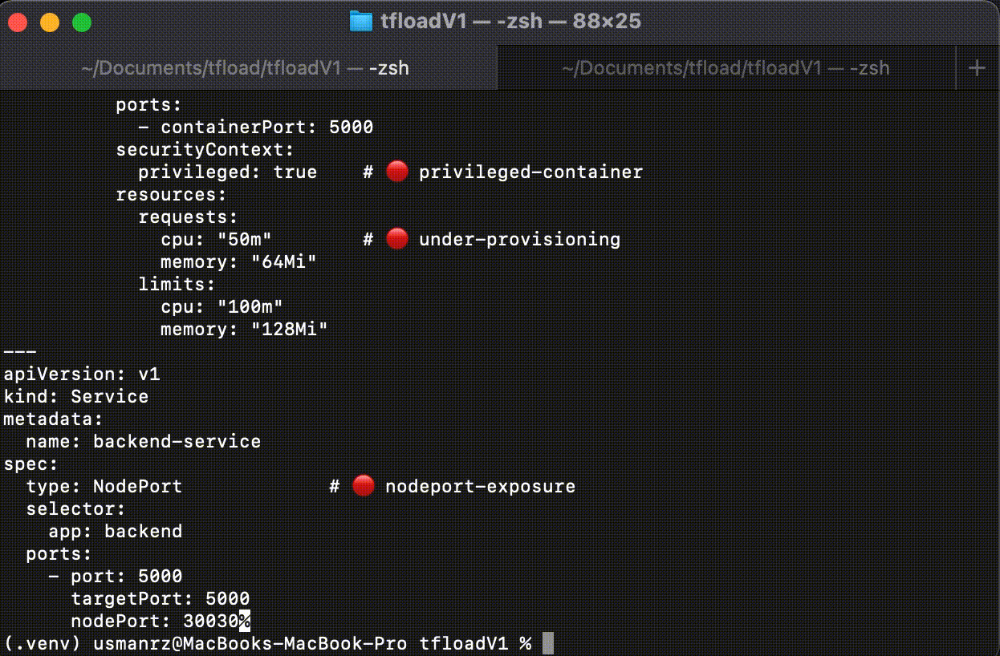

# TRL — Pre-Deployment Intelligence for Kubernetes

> Analyze • Optimize • Secure • Validate — before it hits your cluster

## 🎬 Demo

See TRL in action — analyzing a misconfigured Kubernetes manifest in seconds:



**Built by ClariOps** — bringing clarity to Kubernetes operations.

---


## 🚀 What is TRL?

TRL is a CLI-first engine that **analyzes and improves Kubernetes manifests before deployment**. 

It acts as a **pre-deployment intelligence layer**, helping teams detect issues, optimize resources, and enforce best practices.

Deployment is optional — TRL can run purely as an analysis engine or integrate into CI/CD pipelines.

👉 [See system model for how TRL works conceptually](docs/system-model.md)

---

## 📚 Documentation

TRL documentation is structured across multiple layers (architecture, system model, guarantees, and vision).

👉 Start here: [Documentation Index](docs/README.md)


---

## 🔥 Why TRL?

Unlike traditional tools that focus only on linting or validation:

- TRL combines validation, security, and optimization in a single run
- Provides actionable fixes (not just warnings)
- Focuses on pre-deployment intelligence, not post-failure debugging
- Designed for clarity and fast feedback, not complex pipelines

## ⚖️ Comparison

| Tool        | Validation | Security | Optimization | Auto Fix |
|------------|-----------|----------|-------------|---------|
| kube-score | ✅        | ❌       | ❌          | ❌      |
| trivy      | ❌        | ✅       | ❌          | ❌      |
| TRL        | ✅        | ✅       | ✅          | 🚧      |

## 🎯 The Problem

Kubernetes is powerful — but:

* ❌ Over-provisioned resources → wasted cloud cost
* ❌ Under-provisioned apps → instability under load
* ❌ Missing probes → unreliable deployments
* ❌ Security misconfigurations → critical risks
* ❌ Exposure misconfigurations → attack surface

Most tools detect problems **after deployment**.

👉 By then, it's already too late.

---

## 💡 The Solution

TRL shifts validation **left** — into the development phase.

It automatically:

* 🔍 Detects misconfigurations
* ⚙️ Optimizes resource allocation
* 🔐 Flags security risks
* 📊 Provides actionable fixes

Before anything reaches your cluster.

---

## ⚡ Key Capabilities

* 🧠 Intelligent resource optimization (CPU, memory, replicas)
* ⚠️ Validation engine (probes, exposure, scaling)
* 🔐 Security analysis (root user, privileged containers, image tags)
* 📦 Multi-resource support (Deployment, Service, PVC, ConfigMap, Secret, Ingress)
* 🎯 Actionable suggestions with impact + fixes
* 🧪 Dry-run mode for safe analysis

---

## 🔥 Quick Start

```bash
git clone <repo>
cd trl
pip install -r requirements.txt

### Analyze (Fastest)

python -m trl explain ./examples/demo/bad.yaml

### Analyze + Optimize (Recommended)

python -m trl optimize ./examples/demo/bad.yaml --dry-run

### Deploy (Optional)

python -m trl optimize ./examples/demo/good.yaml --target=local
```

---
## 🧭 Command Guide

TRL provides different ways to use the same independent engines.

| Command | Workflow | Purpose |
| :--- | :--- | :--- |
| `trl explain` | `Validator → Security` | Analyze the input without running the Optimizer |
| `trl optimize` | `Optimizer → Validator → Security` | Optimize the deployment state, then analyze the resulting state |
| `trl run` | User-defined workflow | Execute TRL DSL workflows *(experimental)* |
| `trl deploy` | Deployment workflow | Apply prepared output to a target *(optional)* |

### 🔌 Engine Composition

The engines are independent modules.

The workflow determines their order.

The default optimization workflow is:

```text
Optimizer → Validator → Security → Renderer
```

This does **not** mean the engines depend on one another internally.

For example, `Validator` can run without `Optimizer`:

```text
Validator → Security
```

while `optimize` uses the normal preparation workflow:

```text
Optimizer → Validator → Security
```

This allows TRL to remain plug-and-play while still providing predictable default workflows.

---

## 📊 Output Formats

TRL can produce results in different formats depending on the use case.

### CLI

Human-readable output for developers:

```bash
trl explain ./manifest.yaml
```

### JSON

Machine-readable output for CI/CD and automation:

```bash
trl explain ./manifest.yaml --output=json
```

### YAML

Manifest output for workflows that need the resulting Kubernetes configuration:

```bash
trl optimize ./manifest.yaml --output=yaml
```

These formats represent the same TRL processing results for different consumers:

```text
Developer       → CLI
CI/CD / Tools   → JSON
Kubernetes      → YAML
```

When using `--verbose`, the selected reporting mode controls how detailed information is presented. Keep the documentation aligned with the currently supported output modes rather than describing `--verbose` as a separate processing engine or workflow.
---

## 📊 Example Output 
👉 See: [Detailed Output](docs/transparency/output-example.md)

### CLI (Developer)
```bash
   python -m trl explain ./trl/examples/demo/bad.yaml 
```
Output:

```text

━━━━━━━━━━━━━━━━━━━━━━━━━━━━━━━━━━━━━━━━━━━━━━━━━━

📦 Resource: backend

⚠ LOW: under-provisioning

⚠ MEDIUM: no-readiness-probe

⚠ MEDIUM: no-liveness-probe

⚠ LOW: latest-tag

⚠ MEDIUM: run-as-root

━━━━━━━━━━━━━━━━━━━━━━━━━━━━━━━━━━━━━━━━━━━━━━━━━━

📦 Resource: backend-service

⚠ MEDIUM: nodeport-exposure

━━━━━━━━━━━━━━━━━━━━━━━━━━━━━━━━━━━━━━━━━━━━━━━━━━

📊 Summary
Errors: 0	Warnings: 6	Optimizations: 0

✔ Status: PASSED

```
---

### JSON (CI/CD / Tools)
```bash
   python -m trl explain ./trl/examples/demo/bad.yaml --output=json 
```
Output:

```json
{
  "status": "PASSED",
  "summary": {
    "errors": 0,
    "warnings": 6,
    "optimizations": 0
  },
  "resources": {
    "backend": {
      "errors": [],
      "warnings": [
        {
          "rule": "under-provisioning",
          "severity": "low",
          "category": "reliability"
        },
        {
          "rule": "no-readiness-probe",
          "severity": "medium",
          "category": "reliability"
        },
        {
          "rule": "no-liveness-probe",
          "severity": "medium",
          "category": "reliability"
        },
        {
          "rule": "latest-tag",
          "severity": "low",
          "category": "generic"
        },
        {
          "rule": "run-as-root",
          "severity": "medium",
          "category": "security"
        }
      ],
      "optimizations": []
    },
    "backend-service": {
      "errors": [],
      "warnings": [
        {
          "rule": "nodeport-exposure",
          "severity": "medium",
          "category": "network"
        }
      ],
      "optimizations": []
    }
  }
}
```

### YAML (Kubernetes)
```bash
   python -m trl explain ./trl/examples/demo/bad.yaml --output=yaml 
```

Output: 

```yaml
apiVersion: apps/v1
kind: Deployment
metadata:
  name: backend
  labels:
    app: backend
spec:
  replicas: 1
  selector:
    matchLabels:
      app: backend
  template:
    metadata:
      labels:
        app: backend
    spec:
      containers:
      - name: backend
        image: nginx:latest
        ports:
        - containerPort: 5000
        resources:
          requests:
            cpu: 50m
            memory: 64Mi
          limits:
            cpu: 100m
            memory: 128Mi
---
apiVersion: v1
kind: Service
metadata:
  name: backend-service
spec:
  type: NodePort
  selector:
    app: backend
  ports:
  - port: 5000
    protocol: TCP
    targetPort: 5000
    nodePort: 30030

```
---
## 🧪 Example Manifests

```bash
examples/demo/bad.yaml   # intentionally misconfigured
examples/demo/good.yaml  # optimized version
```

Run:

```bash
trl optimize ./examples/demo/bad.yaml --dry-run
```
Run with Deployment(Optional):
```bash
trl optimize ./examples/demo/bad.yaml --target=local
```


---
## 🔄 CI/CD Integration

TRL is designed to run in pipelines.

Example using GitHub Actions:

```yaml
- name: Run TRL
  run: |
    python -m trl optimize ./k8s.yaml --dry-run --output=json > report.json

- name: Fail if issues found
  run: |
    cat report.json | jq -r '.status' | grep FAILED && exit 1 || exit 0
```

---

## 📦 Helm Support

TRL does not directly parse Helm charts.

Instead, it works with **rendered Kubernetes manifests**, enabling seamless integration with Helm workflows.

```bash 
helm create mychart
helm template ./examples/helmCharts/mychart | python -m trl optimize - --dry-run 
```

This approach:

* avoids re-implementing Helm
* works with any chart
* keeps TRL lightweight and fast

Native Helm support is planned in future releases.

---

## 🏗 How It Works

TRL follows a pipeline-based architecture:

1. Load manifests → convert into IR (Intermediate Representation)
2. Run engines in order:

   * Optimizer (applies safe improvements)
   * Validator (detects misconfigurations)
   * Security (detects risks)

3. Render final manifests from IR
4. (Optional) Deploy to cluster

👉 See full architecture:
docs/architecture.md


---

## 🧠 Core Philosophy

> Fix problems before they reach the cluster.

---

## 👥 Who is this for?

* DevOps Engineers
* Backend developers deploying to Kubernetes
* Startups optimizing cloud cost
* Teams enforcing deployment best practices

---

## ⚠️ Current Status

* CLI: ✅ Stable
* Engines: ✅ Functional
* Multi-resource support: ✅
* Cloud deployment: ⚠️ In progress

---

## 🗺 Roadmap

* Auto-fix engine for safe automated remediation
* Cloud-specific adaptation layer (AKS, GKE, EKS)
* Relationship-aware analysis (cross-resource intelligence)
* Rule expansion (cost + reliability)
* AI-powered suggestions
* SaaS platform (hosted analysis)
* Multi-orchestrator support

---

Experimental DSL support is under development and will be introduced in future releases.

## 🤝 Contributing

Contributions are welcome!

Please see [CONTRIBUTING.md](CONTRIBUTING.md) for guidelines, rules, and architecture details.

We are currently stabilizing the core system, so we recommend reviewing the contribution rules before submitting changes.


## 📜 License

© 2026 ClariOps. Licensed under the Apache License 2.0 — see [LICENSE](LICENSE) for details.

##

---

## 🧩 About ClariOps

ClariOps builds developer-first tools focused on clarity, reliability, and intelligence in Kubernetes and DevOps.

TRL is the first step toward a broader platform for pre-deployment intelligence.
